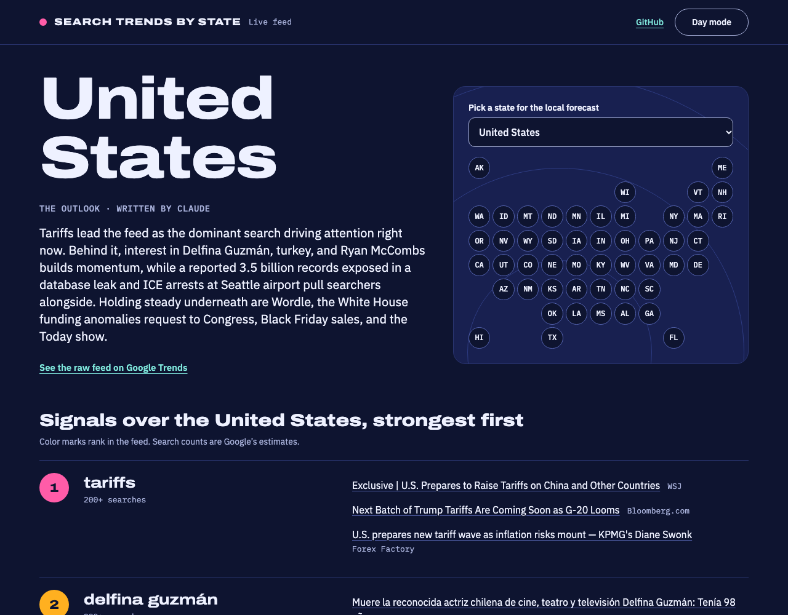

# Search by State Trends



News topics for every US state, built for sales reps who want a local opener: pick your customer's state and see what's trending on Google there, summarized by Claude.

## What it does

1. Pick a state on the tile map or from the dropdown.
2. The app fetches that state's real-time Google Trends feed.
3. Claude (Anthropic API) reads the trends and writes three sentences on the topics you can open with.
4. Claude's summary sits beside the map, with the ranked trends and their news sources below.

No database, no auth, no persistent storage — just a live lookup against Google Trends and a Claude call for the summary.

## Tech stack

- **Next.js** (App Router, API routes) + React
- **Google Trends** RSS/XML export, parsed server-side
- **Claude API** (Anthropic) for trend summaries
- **Tailwind CSS** for styling
- **Vitest** for tests

## Getting started

```bash
git clone https://github.com/dfrho/trends-summary.git
cd trends-summary
npm install
```

Set up your environment variables:

```bash
cp .env.example .env.local
```

Then edit `.env.local` and add your Anthropic API key:

```bash
ANTHROPIC_API_KEY=sk-ant-your-actual-api-key
```

Run the dev server:

```bash
npm run dev
```

Open [http://localhost:3000](http://localhost:3000).

## Testing

```bash
npm test        # run once
npm run test:watch
```

## Use cases

- A local opener before a sales call with a customer in another state
- A one-page PDF of a state's news topics to take into a meeting

## Contributing

Contributions are welcome — feel free to open a Pull Request.

## License

MIT — see [LICENSE.md](LICENSE.md).

## Disclaimer

Not affiliated with, endorsed by, or sponsored by Google. Uses publicly available data from Google Trends' client-exported RSS feed.
